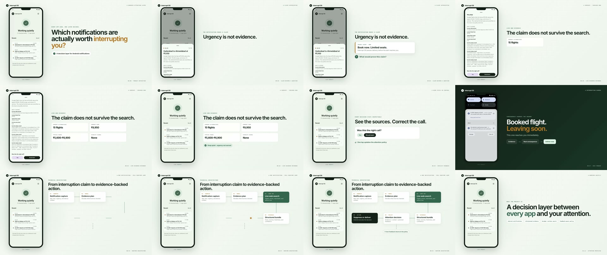
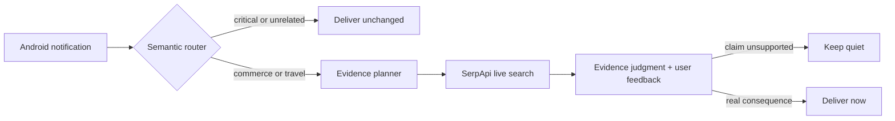

# Interrupt OS

**A decision layer between every app and your attention.**

Interrupt OS is an Android attention agent. When an app makes a time-sensitive
claim, it decides what evidence would resolve that claim, searches the live web
through SerpApi, and then either delivers the notification or lets it stay quiet.
Calls, alarms, navigation, conversations, and other consequential notifications
fail open and arrive immediately.



[Watch the 83-second product walkthrough](https://youtu.be/aAxrcv7zvlo)

Built for the **AI Agents** track of the SerpApi India Hackathon 2026.

## Why it exists

Notifications ask people to make decisions with almost no context: *limited
seats*, *price drop*, *book now*. Android can tell which app sent an alert, but
not whether the claim deserves a person's attention.

Interrupt OS treats interruption as a decision that should be earned. It works
ambiently, exposes its evidence when the user wants to inspect a decision, and
learns from corrections without turning them into brittle sender rules or fixed
price thresholds.

## How a notification is decided

1. Android captures an eligible notification.
2. A fast semantic router identifies whether live evidence could improve the
   decision. Critical and unrelated notifications fail open.
3. A model creates an evidence plan from the notification claim.
4. SerpApi retrieves current product, merchant, flight, fare, and status data.
5. A model judges the claim against that evidence and recent user feedback.
6. Android suppresses the alert or delivers a replacement notification with a
   concise reason and inspectable sources.



## Why SerpApi is essential

The product does not query a prebuilt corpus or add search as a cosmetic step.
Each eligible notification produces a runtime evidence plan, and the resulting
live search data directly changes whether the user is interrupted.

The backend currently uses:

- Google Shopping and Google Product for exact-product offers and merchant
  comparisons.
- Google Flights for current alternatives, fares, and price insights.
- Google Flights Deals for destination-level deal claims.
- Google Search for current flight-status evidence.

If search or model evaluation fails, Interrupt OS preserves the original
notification. It never suppresses on missing evidence.

## Repository

- `android/app`: the Android notification listener, local encrypted history,
  evidence UI, feedback loop, and replacement notifications.
- `backend`: the TypeScript decision service and AWS SAM infrastructure.
- `android/fixture-retail` and `android/fixture-travel`: isolated notification
  source apps used for end-to-end QA.
- `videos/interrupt-os-demo`: the reproducible HyperFrames project and final
  83-second product walkthrough.
- `docs`: architecture, experiment notes, and implementation plans.

No provider credentials or deployed service URL are stored in the repository.
The production deployment keeps provider keys in AWS Secrets Manager and issues
installation-scoped, expiring credentials.

## Run the decision service

Requirements: Node.js 24+, npm, and SerpApi, OpenAI, and TypeSafe API keys.

```sh
cd backend
cp .env.example .env
# Add your own keys to .env.
set -a
source .env
set +a
npm install
npm run typecheck
npm test
npm run start
```

The local service listens on `http://localhost:8787`.

## Run the Android app

Requirements: Android Studio or a Java 17 toolchain with Android SDK 37.

With the backend running, the default Android build connects an emulator to
`http://10.0.2.2:8787`:

```sh
cd android
./gradlew :app:assembleDebug \
  :fixture-retail:assembleDebug \
  :fixture-travel:assembleDebug
./gradlew :app:installDebug
```

For a backend on another host, pass a project property at build time:

```sh
./gradlew -PdecisionApiBaseUrl=https://your-service.example \
  :app:assembleDebug
```

Open Interrupt OS once, grant notification access, and then post a notification
from either fixture app or another installed app.

## Reproduce a live scenario

The QA harness discovers a current product or route, retrieves fresh SerpApi
evidence, and supplies only the resulting notification payload to a fixture app.
Interrupt OS receives no expected answer and performs its own routing, search,
and judgment.

```sh
cd backend
set -a
source .env
set +a
npm run qa:scenario -- commerce-drop
npm run qa:scenario -- commerce-ordinary --post
npm run qa:scenario -- --post-latest
```

## Verification

The release was checked with:

```sh
cd backend && npm run typecheck && npm test && npm run build
cd ../android && ./gradlew :app:assembleDebug \
  :fixture-retail:assembleDebug :fixture-travel:assembleDebug
cd ../videos/interrupt-os-demo && npm run check
```

## AI and media disclosure

OpenAI Codex was used for AI-assisted development. Runtime reasoning uses OpenAI
and TypeSafe/Jev. The product video was composed with HyperFrames, with narration
and music generated through ElevenLabs. All Android footage in the walkthrough
comes from the working application and its QA fixtures.
